# Yoshi Ghost

A retro browser-based endless side-scroller: pilot **Yoshi in a ghost bedsheet costume**, spit fireballs, blast lasers, and dodge your way between the haunted **Ghost Manor** and sunny **Yoshi Island**. Built as a single HTML file with vanilla JavaScript and the HTML5 Canvas API — all character, enemy, and world art generated with [Higgsfield](https://higgsfield.ai).

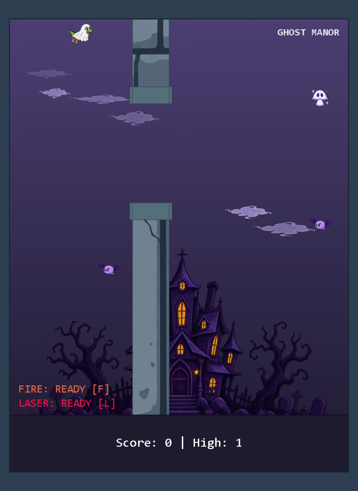

## How to Play

1. Open `index.html` in a browser (or serve via `python -m http.server 8080`)
2. Click, tap, or press **Space** to start and jump
3. Press **F** to spit a fireball and defeat enemies
4. Press **L** to fire the laser (20s recharge) and blast holes through pipes
5. Fly through **red gates** to activate Impossible Mode (reversed gravity for 10s)
6. Grab a floating **Ghost Mushroom** to phase through pipes and gates for 6s
7. Score 12 points to flip between **Ghost Manor** and **Yoshi Island**

## Controls

| Input | Action |
|-------|--------|
| Space / Click / Tap | Jump (or start/restart) |
| F | Spit fireball (defeats enemies, short cooldown) |
| L | Fire laser (blasts holes through pipes/gates) |

## Characters & Creatures

All sprites below are AI-generated (Higgsfield, flat-cartoon style) and rendered with a transparent-background fallback to the original procedural canvas drawing if an image ever fails to load.

<table>
<tr>
<td align="center" width="260">
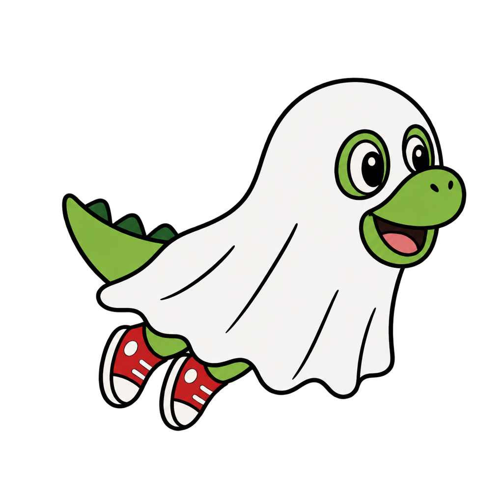<br>
<b>Yoshi Ghost</b><br>
The player character — a Yoshi hiding under a bedsheet ghost costume, spitting fireballs across two haunted/tropical worlds.
</td>
<td align="center" width="260">
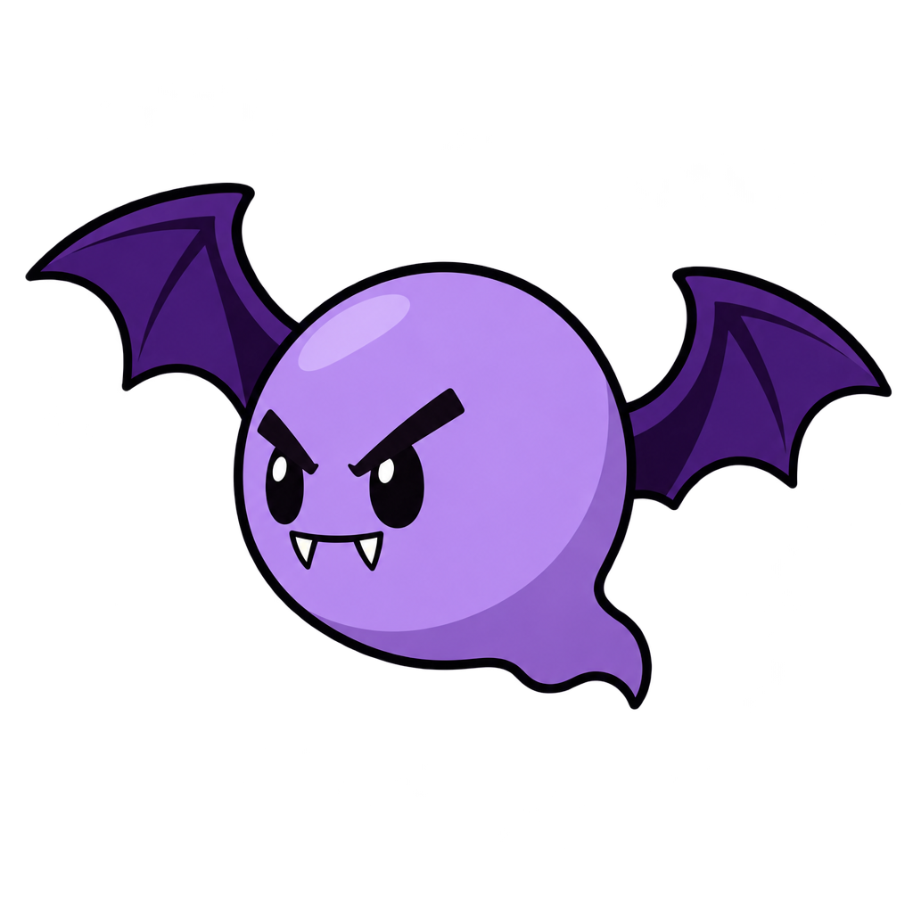<br>
<b>Manor Bat-Ghost</b><br>
A spooky flying enemy native to Ghost Manor. Defeat it with a fireball for a point.
</td>
<td align="center" width="260">
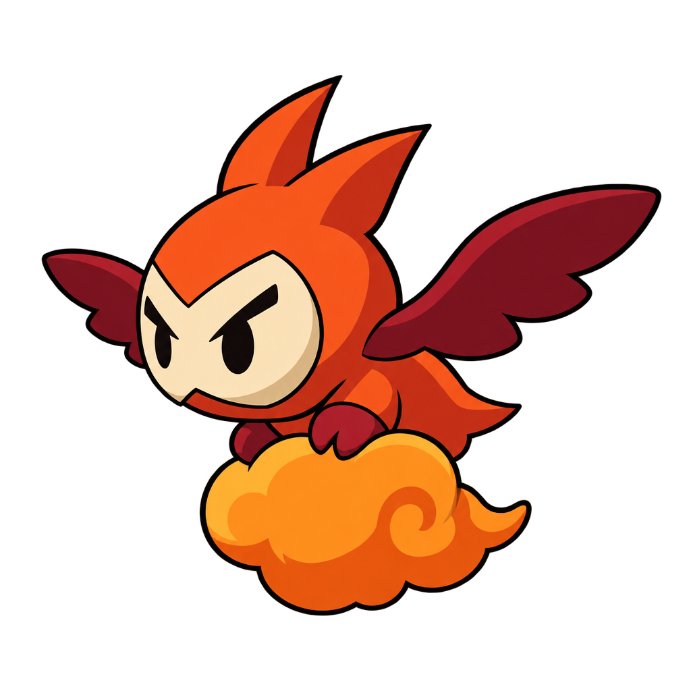<br>
<b>Island Sky Imp</b><br>
A masked imp riding a cloud puff, patrolling the skies of Yoshi Island.
</td>
</tr>
<tr>
<td align="center" width="260">
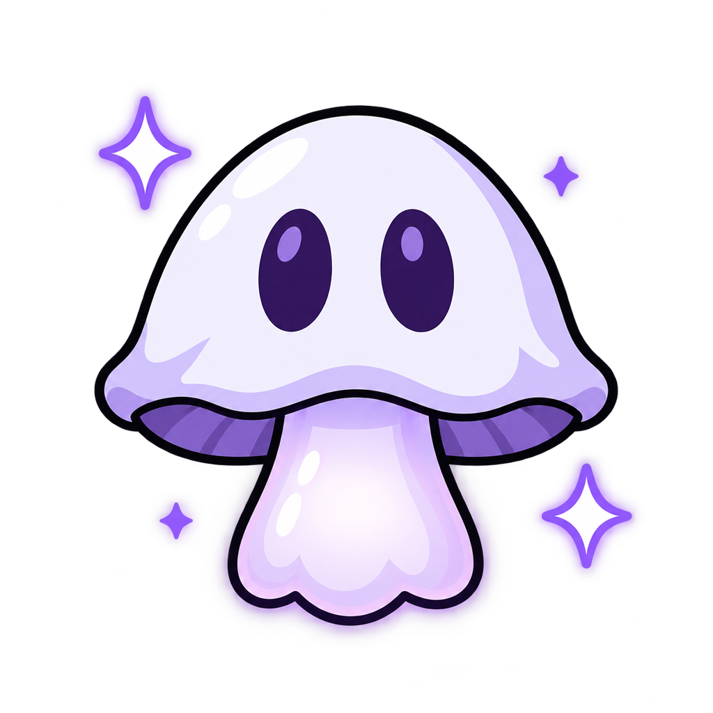<br>
<b>Ghost Mushroom</b><br>
A rare powerup — collect it to phase through pipes and gates for 6 seconds (ground is still solid).
</td>
<td align="center" width="260">
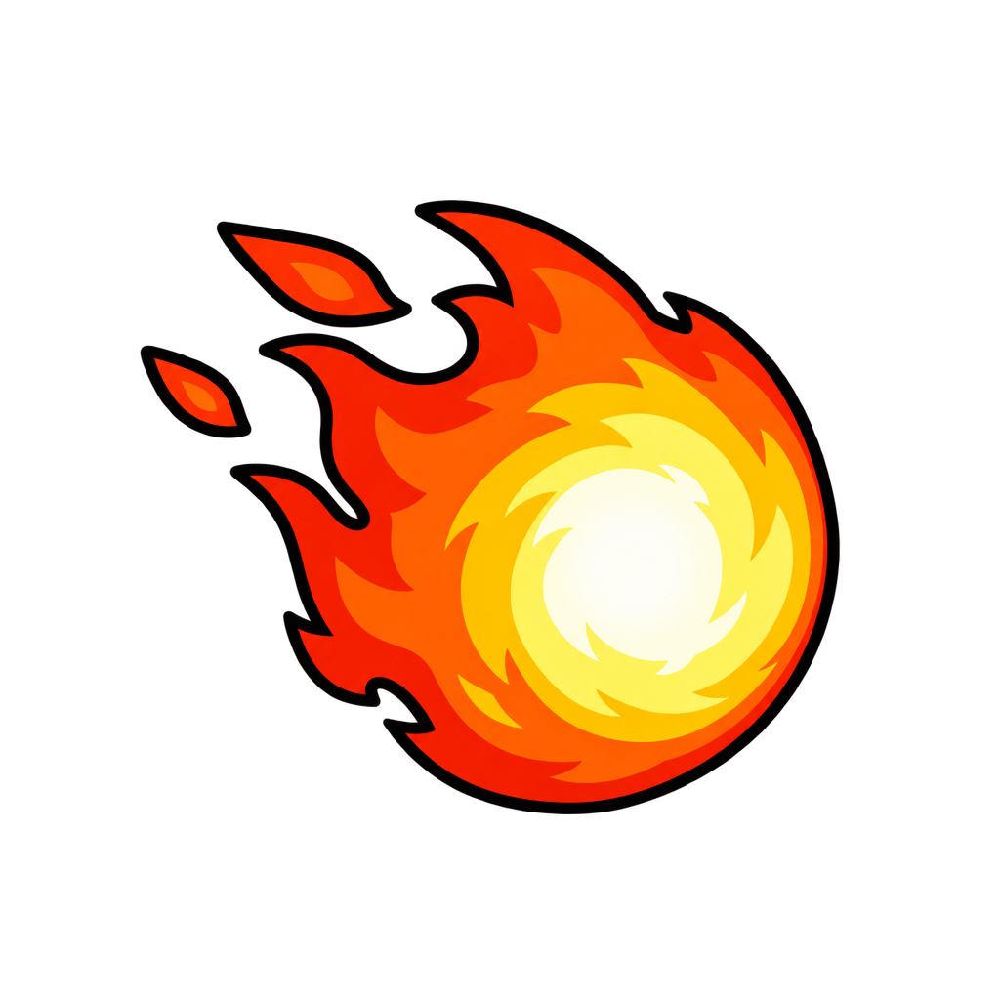<br>
<b>Fireball</b><br>
Yoshi's ranged attack, fired with <b>F</b>, defeats enemies on contact.
</td>
<td align="center" width="260">
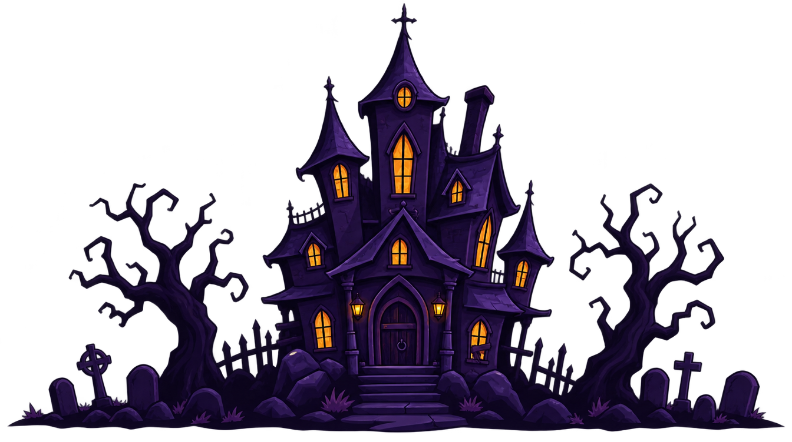<br>
<b>Ghost Manor</b><br>
World backdrop — a crooked haunted mansion with twisted trees and tombstones.
</td>
</tr>
</table>

<p align="center">
  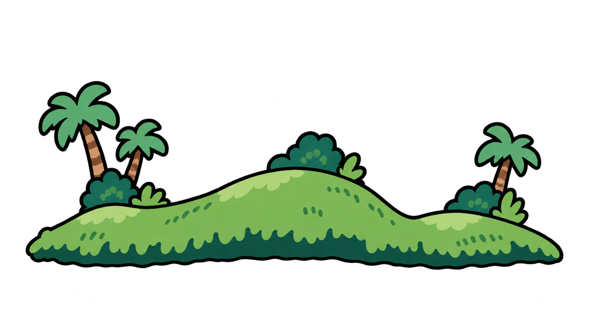<br>
  <sub>Yoshi Island — the second world, unlocked every 12 points</sub>
</p>

## Features

- Gravity-based physics with delta-time integration
- Two alternating worlds (Ghost Manor / Yoshi Island) that swap every 12 points, each with its own palette, pipe texture, clouds, and enemy
- Flying enemies defeated with fireballs (**F**)
- **Ghost Mushroom** powerup: temporary wall-phasing through pipes/gates, with a pulsing translucent glow on Yoshi while active
- Laser beam that blasts holes through pipes and gates (**L**)
- Red impossible gates that reverse gravity for 10 seconds — fixed to never re-stack/re-trigger from a second gate queued before the first is crossed
- Parallax cloud layers with varying opacity and speed, themed per world
- Score and high score persistence via localStorage
- Screen shake on collision, particle/defeat effects
- Velocity-based Yoshi tilt animation, idle bob on start screen
- Custom TTS-recreated Yoshi voice lines on level start and death
- Touch support for mobile
- 1.5x scaled canvas (720×960) for larger, clearer sprites and UI

## Project Structure

```
├── index.html              # Single-file game (HTML + CSS + JS)
├── game-config.json        # Physics parameters reference
├── assets/
│   ├── sprites/             # AI-generated game art (Higgsfield)
│   │   ├── yoshi-ghost.png     # Player character
│   │   ├── enemy-ghost-manor.png
│   │   ├── enemy-yoshi-island.png
│   │   ├── ghost-mushroom.png  # Wall-phasing powerup
│   │   ├── fireball.png
│   │   ├── cloud-ghost.png / cloud-island.png
│   │   ├── hill-island.png / manor-ghost.png   # World backdrops
│   │   └── pipe-ghost.png / pipe-island.png    # Pipe column textures
│   ├── yoshi_start.wav     # Level start voice line
│   ├── yoshi_death.wav     # Death voice line
│   ├── jump.wav            # Jump sound effect
│   ├── game_over.wav       # Legacy sound effect (unused, kept for reference)
│   └── ghosty.png          # Legacy sprite (unused, kept for reference)
├── img/
│   ├── gameplay-ghost-manor.png
│   └── gameplay-island-world.png
└── .kiro/
    ├── specs/flappy-kiro/
    │   ├── requirements.md
    │   ├── design.md
    │   └── tasks.md
    └── steering/
        ├── game-coding-standards.md
        ├── game-architecture.md
        ├── game-mechanics.md
        ├── canvas-and-collision.md
        └── visual-design.md
```

## CONFIG Object

All tunable constants live in a single `CONFIG` object exposed on `window.CONFIG` for live console tweaking. Values are scaled 1.5x from the original layout:

| Path | Default | Description |
|------|---------|--------------|
| `gravity` | 1200 | Downward acceleration (px/s²) |
| `jumpVelocity` | -450 | Upward velocity on jump (px/s) |
| `pipe.speed` | 180 | Horizontal pipe speed (px/s) |
| `pipe.gap` | 210 | Vertical gap between pipes (px) |
| `wall.spacing` | 525 | Distance between pipe spawns (px) |
| `enemy.hitboxScale` | 0.55 | Enemy collision box as a fraction of sprite size (centered) |
| `powerup.duration` | 6 | Ghost Mushroom wall-phasing duration (s) |
| `impossible.duration` | 10 | Reversed gravity duration (s) |
| `laser.rechargeTime` | 20 | Laser cooldown (s) |
| `laser.holeSize` | 90 | Size of laser holes (px) |

## Architecture

### Game State Machine

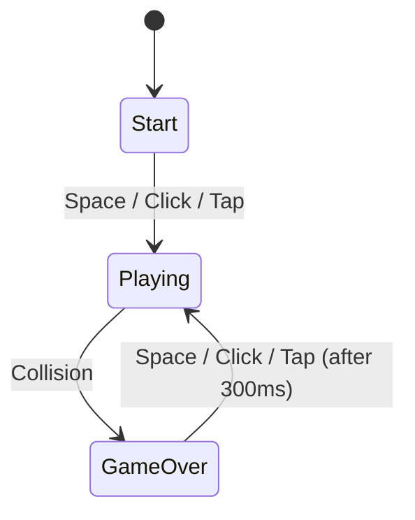

### Game Loop (Playing State)

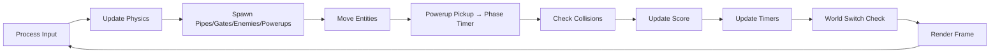

### System Modules

```mermaid
graph TD
    CONFIG[CONFIG Object] --> Physics
    CONFIG --> PipeManager
    CONFIG --> CloudManager
    CONFIG --> CollisionDetector
    CONFIG --> Renderer
    CONFIG --> LaserSystem
    CONFIG --> GateSystem
    CONFIG --> EnemySystem
    CONFIG --> PowerupSystem
    CONFIG --> FireballSystem
    CONFIG --> WorldSystem

    subgraph Core Logic
        Physics[Physics Engine<br/>updateKiro, jump]
        PipeManager[Pipe Manager<br/>spawnPipe, updatePipes, checkPipePass]
        CloudManager[Cloud Manager<br/>initClouds, updateClouds]
        CollisionDetector[Collision Detector<br/>checkCollision, isInHole, phasing]
        Scoring[Scoring<br/>formatScore, updateHighScore]
        GateSystem[Gate System<br/>spawnGate, updateGates, checkGatePass, hasPendingGate]
        LaserSystem[Laser System<br/>fireLaser, updateLaser]
        EnemySystem[Enemy System<br/>spawnEnemy, updateEnemies, checkEnemyCollision]
        PowerupSystem[Powerup System<br/>spawnPowerup, updatePowerups, checkPowerupCollision]
        FireballSystem[Fireball System<br/>fireFireball, updateFireballCollisions]
        WorldSystem[World System<br/>worldForScore, getWorldTheme]
    end

    subgraph Presentation
        Renderer[Renderer<br/>render]
        AudioManager[Audio Manager<br/>playSound]
        SpriteManager[Sprite Manager<br/>loadSprite, spriteReady]
    end

    subgraph Infrastructure
        InputHandler[Input Handler<br/>handleInput]
        GameLoop[Game Loop<br/>gameLoop, idleLoop]
        Persistence[Persistence<br/>loadHighScore, saveHighScore]
    end

    GameLoop --> Physics
    GameLoop --> PipeManager
    GameLoop --> CloudManager
    GameLoop --> CollisionDetector
    GameLoop --> Scoring
    GameLoop --> GateSystem
    GameLoop --> LaserSystem
    GameLoop --> EnemySystem
    GameLoop --> PowerupSystem
    GameLoop --> FireballSystem
    GameLoop --> WorldSystem
    GameLoop --> Renderer
    Renderer --> SpriteManager
    InputHandler --> GameLoop
    InputHandler --> LaserSystem
    InputHandler --> FireballSystem
```

### Collision Detection Flow

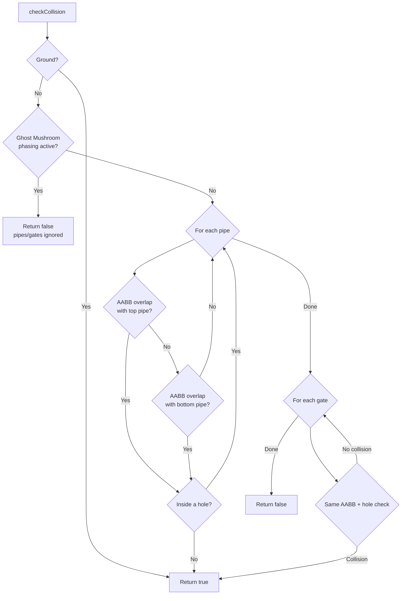

### Impossible Mode Flow

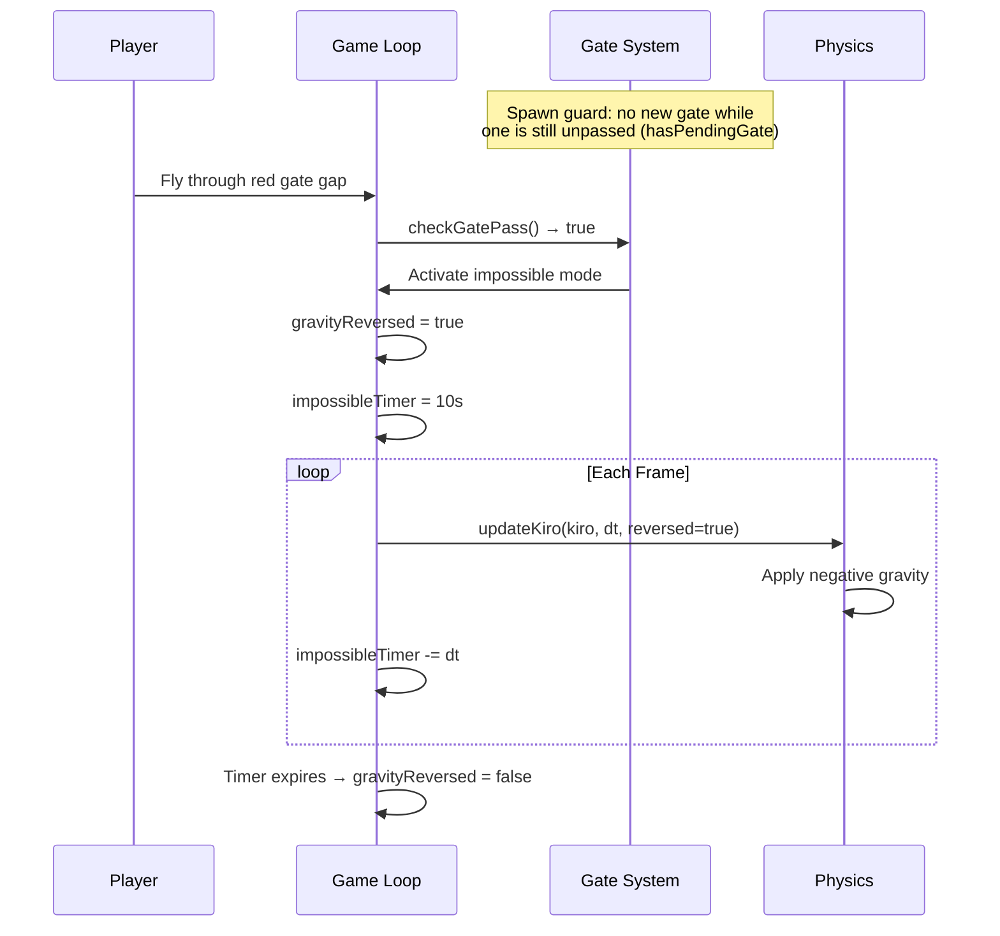

### Ghost Mushroom Powerup Flow

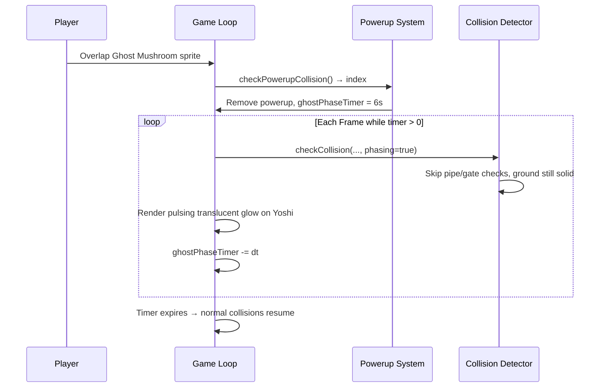

### Laser System Flow

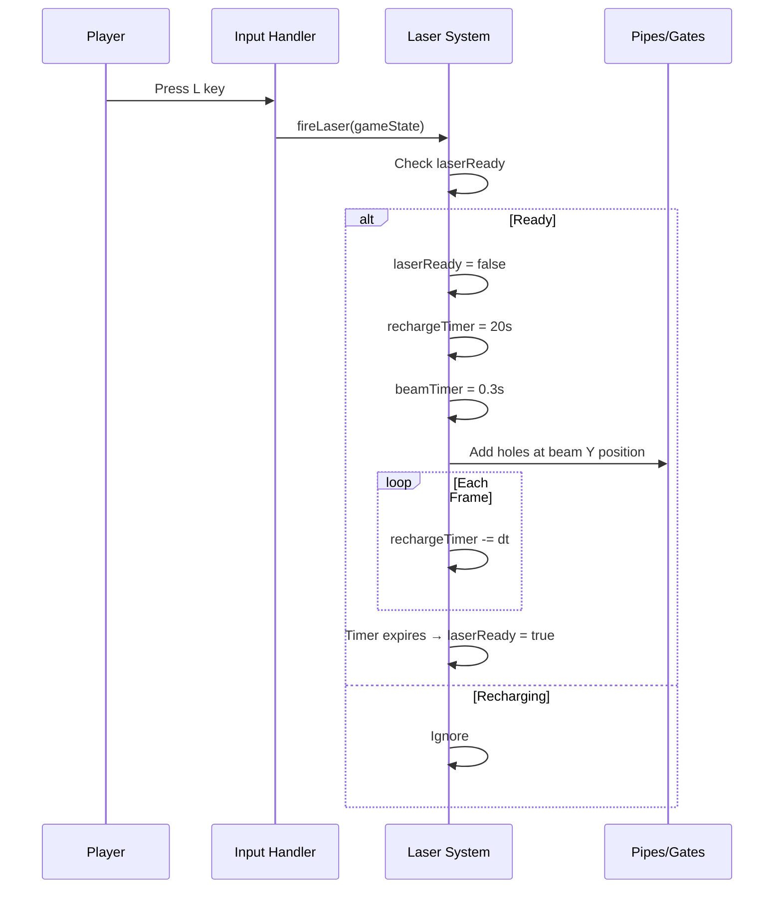

## Credits

Character, enemy, powerup, and background art generated with [Higgsfield](https://higgsfield.ai). Voice lines are an original TTS recreation, not sourced from any copyrighted game audio. Built with [Kiro](https://kiro.dev).

## License

See [LICENCE.md](LICENCE.md).
